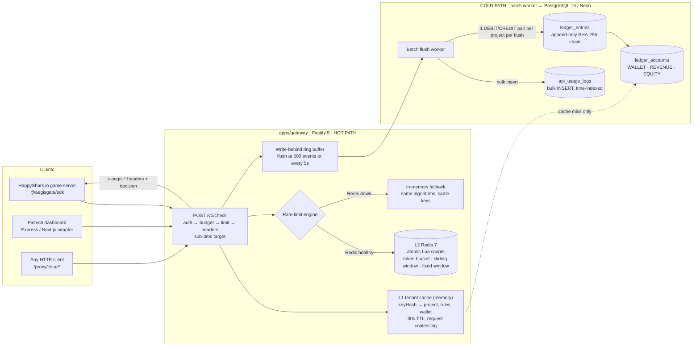
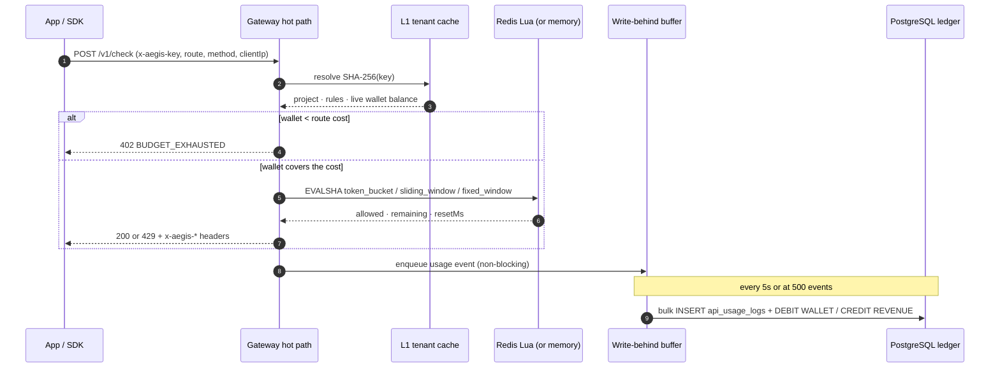

<div align="center">

# 🛡️ AegisGate

### Cloud-Native Distributed API Gateway, Rate-Limiter & Usage-Based Double-Entry Billing Engine

Protect any HTTP or WebSocket API with atomic rate limiting, prepaid credit budgets and an auditable,
SHA-256 hash-chained double-entry ledger, delivered as one gateway, one SDK, one CLI and one console.

`TypeScript 5` · `Fastify 5` · `Redis 7 Lua` · `PostgreSQL 16 + Drizzle` · `Next.js 14` · `pnpm workspaces`

</div>

---

## What's inside (4-in-1)

| Deliverable | Path | What it does |
|---|---|---|
| **High-Throughput Edge Gateway** | [`apps/gateway`](apps/gateway) | Fastify 5 decision API (`POST /v1/check`), zero-code reverse proxy (`/proxy/:slug/*`), Redis Lua rate limiter with in-memory fallback, write-behind billing worker, control-plane API |
| **Universal Middleware SDK** | [`packages/sdk`](packages/sdk) | `AegisGateClient` plus Express, Fastify and Next.js adapters and a synchronous WebSocket frame limiter. Fails open by default |
| **Geek ANSI Terminal War-Room** | [`apps/cli`](apps/cli) | `aegis sim`, `aegis bench`, `aegis top`: zero-dependency ANSI dashboards and a concurrent load generator |
| **Interactive Control Plane & FinOps Sandbox** | [`apps/console`](apps/console) | Next.js console: tenant onboarding, chaos lab, rule editor, ledger inspector, pricing simulator. Runs against the live gateway or a full in-browser engine |

Supporting packages: [`packages/shared`](packages/shared) (Zod wire contracts, isomorphic SHA-256, rate-limit
algorithms, burst simulator, route matcher) and [`packages/db`](packages/db) (Drizzle schema, ACID
double-entry ledger service, idempotent seed).

**Every layer degrades instead of failing:** no Redis → in-memory limiter with identical semantics;
no Postgres → in-memory showcase tenants with a live hash-chained ledger; no gateway → the console runs the
same engine in the browser; gateway unreachable from the SDK → requests fail open.

---

## System architecture



**Hot path (per request, synchronous):** hash the API key → L1 tenant lookup (a Postgres hit only on a cache
miss, at most once per key per 30s) → match the route rule → check the prepaid wallet → run one atomic Redis
Lua script (or the identical in-memory algorithm) → return the decision with `x-aegis-*` headers. Nothing on
this path writes to Postgres.

**Cold path (asynchronous, batched):** every decision is pushed into a bounded write-behind buffer. The batch
worker bulk-inserts telemetry and posts **one** balanced ledger transaction per project per flush, so any
number of requests in a 5-second window costs one wallet row lock per project instead of one per request. Wallets are debited
optimistically in memory (`live balance = settled balance − unsettled edge charges`) and reconciled on
every L1 refresh.

### Request lifecycle (`POST /v1/check`)



### Rate-limit algorithms and the boundary-burst problem

All three algorithms run as atomic Redis Lua scripts and, with identical semantics, as an in-memory
implementation in `@aegisgate/shared` (used for the Redis-down fallback, the simulator and the browser engine).
Limits are keyed per **API key × rule × client IP**. Each request consumes one limiter unit; the rule's
`costWeightCredits` is what gets billed.

200 requests fired between t = 59.9s and t = 60.1s against `limit 100 / 60s, burst 120`
(`npx pnpm@9.12.0 cli:sim`, asserted by the test suite):

| Algorithm | Admitted | Peak in any 60s window | Verdict |
|---|---:|---:|---|
| Fixed window | 200 | **200 (200% of limit)** | ✖ counter resets at the boundary, so an attacker gets 2× the limit |
| Sliding window | 100 | 100 | ✔ strict cap over the trailing 60s |
| Token bucket | 120 | 120 | ✔ bounded by burst capacity, refills at 100/60s |

AegisGate defaults to the token bucket (bursty-but-bounded traffic such as room joins) and uses the sliding
window where a hard cap matters (HappyShark's 60 FPS frame relay, Fintech quote polling).

### Graceful degradation

| Dependency down | Behavior |
|---|---|
| Redis | Warns once, switches to the in-memory limiter, and reconnects in the background with backoff |
| PostgreSQL | Tenant config served from stale L1 entries; the 3 showcase tenants (and projects created meanwhile) run from an in-memory store with a live hash-chained ledger; `GET /v1/admin/overview` reports `dataSource: "offline-showcase"` |
| PostgreSQL during a flush | Telemetry is re-queued (buffer capped at 50,000 events); failed ledger settlements are retried on the next flush |
| Gateway (SDK side) | `failOpen: true` (default) admits traffic with `reason: "FAIL_OPEN_FALLBACK"`; `failOpen: false` returns 503 |
| Gateway (console side) | The console switches to its in-browser engine: same tenants, algorithms and ledger |

---

## Database schema & double-entry accounting


Indexes: `ledger_entries (project_id, created_at)`, `api_usage_logs (project_id, created_at)` and
`api_usage_logs (status_code, created_at)`; `api_keys.key_hash` and `ledger_accounts.account_code` are unique.

### Postings

| Event | DEBIT (balance −) | CREDIT (balance +) |
|---|---|---|
| Wallet funding at onboarding / top-up | `SYSTEM:EQUITY_SEED` | `WALLET:<slug>` |
| Batch usage settlement | `WALLET:<slug>` | `PLATFORM:REVENUE` |

### Why a hash-chained double-entry ledger instead of `UPDATE wallets SET balance = balance - x`

- **Every balance change has a counter-entry.** A transaction is exactly one DEBIT and one CREDIT of the same
  positive amount sharing a `transaction_id`, so `Σ DEBIT = Σ CREDIT` and all balances sum to zero. A
  balance can always be rebuilt from the journal, and `balance_after` on each row records the state at that
  moment.
- **Tampering is detectable.** `entry_hash = SHA-256(prev_hash | transaction_id | account_id | direction |
  amount_credits | created_at)`, chained per project from a `GENESIS_…` hash. Editing any historical row
  breaks every hash after it. The SHA-256 is a pure-TypeScript implementation in `@aegisgate/shared`, verified
  byte-for-byte against `node:crypto`, so the gateway, Postgres seed, CLI and browser all produce and verify
  identical chains.
- **Concurrency is explicit.** `recordDoubleEntryTransaction` runs in a single Postgres transaction:
  1. `pg_advisory_xact_lock(hashtext(project_id))` serializes writers of one project's chain, so the chain
     has a single tip and never forks.
  2. `SELECT … FOR UPDATE` locks both accounts **ordered by id**, so two opposite transfers cannot deadlock.
  3. Both balances are updated with `balance ± amount … RETURNING`, then the two entries are inserted with
     strictly increasing timestamps.
- **It stays off the hot path.** Requests are charged optimistically in memory and settled in batches, so the
  ledger's locking cost scales with projects × flushes, not with request volume.

The verification suite (`npx pnpm@9.12.0 test`) asserts all of these invariants on a live in-memory ledger,
including that a one-credit edit to a historical entry is detected.

---

## Real-world integration

### HappyShark.io: HTTP room joins + 60 Hz WebSocket anti-cheat

```ts
import { AegisGateClient, createExpressMiddleware } from '@aegisgate/sdk';

const aegis = new AegisGateClient({ apiKey: process.env.AEGIS_KEY!, gatewayUrl: 'http://localhost:4000' });
app.use('/api', createExpressMiddleware(aegis)); // /api/room/join → token_bucket 20/60s, burst 30, 5 credits

wss.on('connection', (socket, req) => {
  const playerId = String(req.headers['x-player-id']);
  socket.on('message', (frame) => {
    if (!aegis.checkWebSocketFrame(playerId).allowed) return; // drop speed-hack packets above 60 FPS
    handleMovement(playerId, frame);
  });
  socket.on('close', () => aegis.releaseWebSocketClient(playerId));
});
```

- `createExpressMiddleware` asks the gateway for a decision on every request, copies the `x-aegis-*` headers
  onto the response and short-circuits with `429` / `402` JSON (`{ error: 'Protected by AegisGate', … }`).
- `checkWebSocketFrame` is **synchronous**, with no network call per packet: an O(1) sliding 1-second counter
  per player admits at most `l1FrameLimitPerSec` (default 60) frames/s. Every 20 frames the admitted count
  is reported to the gateway as one `/v1/check` with `costOverride`, so billing and telemetry stay accurate
  at 1/20th of the request volume.

### Fintech Market Dashboard: Next.js App Router route

```ts
// app/api/report/monte-carlo/route.ts → token_bucket 5/60s, 50 credits per report
import { withAegisGateNextHandler } from '@aegisgate/sdk';

export const POST = withAegisGateNextHandler({ apiKey: process.env.AEGIS_KEY! }, async (req) =>
  Response.json(await runMonteCarlo(await req.json())),
);
```

Fastify uses `app.addHook('onRequest', createFastifyHook({ apiKey }))`. Without any code change, clients
can call `http://localhost:4000/proxy/<slug>/<path>` with `x-aegis-key`, and the gateway enforces limits and
budgets before forwarding upstream.

### Gateway API

| Method | Path | Auth | Purpose |
|---|---|---|---|
| `POST` | `/v1/check` | `x-aegis-key` header or `apiKey` body field | Rate-limit + budget decision (SDK / middleware hot path) |
| `ALL` | `/proxy/:slug/*` | `x-aegis-key` (or `?demo=true` for showcase tenants) | Zero-code reverse proxy; `x-aegis-mock-upstream: true` returns a synthetic upstream |
| `POST` | `/v1/simulate-burst` | public | Deterministic algorithm comparison (`boundary_burst`, `steady_flood`) |
| `GET` | `/health` | public | Liveness, limiter backend, write-behind buffer metrics |
| `GET` | `/v1/admin/overview` | public, read-only | Tenants, keys (prefix only), rules, wallets, recent ledger, FinOps, per-route stats |
| `POST` | `/v1/admin/projects` | `x-aegis-admin-secret` | Onboard a project: API key, funded wallet, default rule |
| `POST` | `/v1/admin/rules` | `x-aegis-admin-secret` | Add or update a route rule (invalidates the L1 cache) |
| `POST` | `/v1/admin/flush` | `x-aegis-admin-secret` | Force a write-behind flush + ledger settlement |
| `POST` | `/v1/admin/wallet/topup` | `x-aegis-admin-secret` | Prepaid top-up (DEBIT equity / CREDIT wallet) |

Every decision returns `x-aegis-request-id`, `x-aegis-ratelimit-algo`, `x-aegis-ratelimit-limit`,
`x-aegis-ratelimit-remaining`, `x-aegis-ratelimit-reset` (ms), `x-aegis-gateway-latency-ms` and
`x-aegis-billing-cost-credits`, plus `retry-after` on 429. Status codes: `200` allowed, `429`
`RATE_LIMIT_EXCEEDED`, `402` `BUDGET_EXHAUSTED`, `401` missing/invalid key, `503` tenant store unavailable.

---

## 1-minute quickstart

Requirements: Node.js ≥ 20 (global Web Crypto) and nothing else. pnpm runs through `npx`.

### Zero-dependency mode (no Docker)

```bash
npx pnpm@9.12.0 install
npx pnpm@9.12.0 test          # in-process verification suite, 13 checks in ~0.1s
npx pnpm@9.12.0 cli:sim       # boundary-burst comparison (runs locally if the gateway is down)

npx pnpm@9.12.0 dev:gateway   # :4000, falls back to in-memory limiter + offline showcase tenants
npx pnpm@9.12.0 dev:console   # :3000, uses the live gateway or the in-browser engine
npx pnpm@9.12.0 cli:bench     # 80 checks at concurrency 15 against HappyShark's /api/room/join
npx pnpm@9.12.0 cli:top       # full-screen live telemetry war-room (q to quit)
```

### Full mode (Postgres 16 + Redis 7)

```bash
cp .env.example .env
docker compose up -d          # postgres:16-alpine + redis:7-alpine
npx pnpm@9.12.0 db:push       # create the schema with drizzle-kit
npx pnpm@9.12.0 db:seed       # 3 showcase tenants, funded wallets, 450 historical usage rows (idempotent)
npx pnpm@9.12.0 dev:gateway
npx pnpm@9.12.0 dev:console
```

Showcase tenants and their public demo keys:

| Tenant | Slug | Demo key | Rules |
|---|---|---|---|
| 🦈 HappyShark.io Game Server | `happyshark` | `ag_live_happyshark_demo_key_2026` | `/api/room/join` token bucket 20/60s burst 30 · 5 cr; `/ws/frame` sliding window 60/1s · 1 cr; `*` 120/60s |
| 📊 Fintech Market Dashboard | `fintech-dash` | `ag_live_fintech_demo_key_2026` | `/api/market/quote` sliding window 30/60s · 2 cr; `/api/report/monte-carlo` token bucket 5/60s · 50 cr |
| 🤖 AI Copilot & Sandbox API | `ai-sandbox` | `ag_live_aisandbox_demo_key_2026` | `/v1/chat/completions` token bucket 10/60s burst 15 · 100 cr |

```bash
curl -s -X POST localhost:4000/v1/check -H 'content-type: application/json' \
  -H 'x-aegis-key: ag_live_happyshark_demo_key_2026' \
  -d '{"route":"/api/room/join","method":"POST","clientIp":"203.0.113.7"}'
curl -i 'localhost:4000/proxy/happyshark/api/room/join?demo=true' -H 'x-aegis-mock-upstream: true'
```

### Console tabs

1. **📡 Live Traffic & Chaos Lab**: fire normal traffic, an 80-request flood or a 120 pkt/s WebSocket
   speed-hack, inspect the exact response headers, and compare the three algorithms on an SVG chart.
2. **🔐 Dynamic Rules & SDK Integration**: edit route rules live and copy Express / Fastify / Next.js /
   WebSocket / proxy / CLI snippets pre-filled with the project's key.
3. **📒 Double-Entry Billing Ledger**: wallet vs platform revenue, the journal grouped by transaction, and
   in-browser re-verification of the SHA-256 chain; trigger a settlement or top-up and watch a new pair append.
4. **💰 FinOps & Pricing Simulator**: per-route revenue, estimated infra cost and margin (flags
   negative-margin routes), plus MRR / ARR / COGS / DDoS-savings projections across three pricing models.

Set `NEXT_PUBLIC_GATEWAY_URL` to point the console at a deployed gateway. Deployed alone (e.g. Vercel), the
console runs entirely on its in-browser engine.

### Verification suite

`scripts/verify-all.ts` runs in-process with no servers, network or Docker, and asserts:

- **Crypto**: SHA-256 FIPS test vectors; byte-identical output to `node:crypto` across 250+ inputs, including
  every padding boundary and multi-byte UTF-8; `generateApiKey` format, 64-hex hash and `hashApiKey` round-trip.
- **Rate limiting**: token bucket burst + refill, sliding window hard cap, route-matcher precedence, and the
  boundary burst (fixed window 200, sliding window 100, token bucket 120).
- **Ledger**: real rule evaluation against the gateway's offline store, onboarding `ntu-course-helper`, rule
  upsert, top-up and settlement, then `Σ DEBIT = Σ CREDIT`, `Σ balances = 0`, every balance equals its journal,
  every `entry_hash` recomputes and links, and a tampered amount is detected.
- **Browser parity**: the console's in-browser engine produces the same decisions and a ledger that passes the
  same invariants.

---

## Repository layout

```
apps/
  gateway/   Fastify edge gateway: check.ts (hot path), limiter.ts (Redis Lua + fallback),
             tenant-cache.ts (L1), batch-worker.ts (write-behind), proxy.ts, admin.ts, showcase-fallback.ts
  cli/       aegis sim | bench | top (zero-dependency ANSI rendering)
  console/   Next.js 14 control plane + in-browser engine (src/lib/local-*.ts)
packages/
  shared/    contracts, isomorphic crypto, rate-limit algorithms, simulator, showcase tenants
  db/        Drizzle schema, double-entry ledger service, seed
  sdk/       AegisGateClient + Express / Fastify / Next.js adapters
scripts/     verify-all.ts + checks/
```

## Design decisions & trade-offs

- **Limiter units vs billing credits.** Every request costs one limiter unit and `costWeightCredits` from the
  wallet. A 100-credit LLM call therefore counts as one request against `10/60s`, not as 100.
- **Write-behind billing.** Throughput and Postgres load scale with flushes, not requests. The cost is that up to
  one flush interval (5s) of usage lives only in gateway memory; a hard crash can lose it (graceful shutdown
  flushes first).
- **Optimistic wallets.** Each gateway instance tracks its own unsettled charges and only sees other instances'
  charges after they settle and its L1 entry refreshes (30s TTL). N instances can therefore overspend a nearly
  empty wallet by up to roughly N × 30s of that tenant's traffic.
- **Fail-open SDK.** An unreachable gateway should not take a game server down; set `failOpen: false` for
  endpoints where protection matters more than availability.
- **Per-IP limit keys.** Limits are scoped to key × rule × client IP, so one abusive player cannot exhaust a
  tenant's whole quota.

## Security notes

- Raw API keys are never stored: lookups use the SHA-256 `key_hash`, and responses echo only the key prefix.
- Mutating admin routes require `x-aegis-admin-secret`, compared in constant time. The fallback
  `ag_admin_master_secret_2026` exists for local development only, so set `AEGIS_ADMIN_SECRET` in any deployment.
- `GET /v1/admin/overview` is intentionally public and read-only for the showcase. The console sends the admin
  secret from the browser (`NEXT_PUBLIC_AEGIS_ADMIN_SECRET`), which is acceptable for a demo but not for production.
- The proxy strips `x-aegis-key`, the admin secret and hop-by-hop headers before forwarding upstream.

## Roadmap

- Monthly range partitioning of `api_usage_logs` (Neon / Postgres declarative partitioning) with retention jobs.
- Distributed wallet reservations in Redis (`DECRBY` with a settlement watermark) to remove per-instance overspend.
- Redis Cluster hash tags and multi-region limiter replication.
- OpenTelemetry traces and Prometheus metrics for the hot path; API key scopes and rotation.
