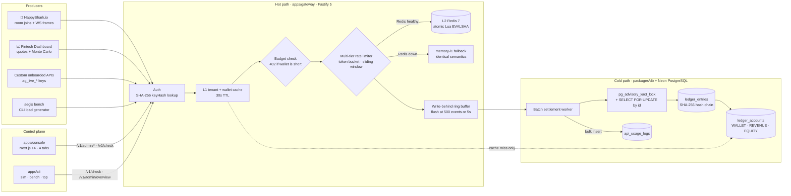
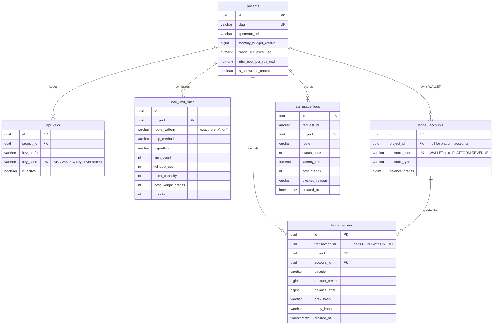

<div align="center">

# 🛡️ AegisGate

### Distributed API Gateway, Multi-Tier Rate Limiter & Cryptographic Double-Entry FinOps Billing Engine


</div>

| Live production ecosystem | |
|---|---|
| 🌐 **Live Control Plane & FinOps War-Room** (Vercel) | **https://aegisgate-ten.vercel.app** |
| ⚡ **Live Edge Gateway Health** (Render + Neon Postgres) | **https://aegisgate-gateway.onrender.com/health** |
| 🦈 **Connected Consumer 1: HappyShark.io** (real-time 60 Hz WebSocket game) | Protected on `/api/room/join` and `/ws/frame` |
| 📈 **Connected Consumer 2: Fintech Market Dashboard** (AI & market data) | Metered on `/api/market/quote` and `/api/report/monte-carlo` |

> If the Render instance is waking from idle, the console waits 4 s for the gateway, then serves the same
> tenants from its in-browser engine and re-probes the gateway every 5 s.

**Latest changes**

- **Production deployment:** gateway on Render backed by Neon Postgres (6 tables, 3 seeded showcase tenants), console on Vercel.
- **Neon-safe DB client:** `channel_binding=…` is stripped from `DATABASE_URL` automatically; a missing URL no longer
  crashes the process, and the gateway serves the offline showcase instead.
- **Full CRUD in the control plane:** `DELETE` for custom projects and rules. Showcase tenants are protected (`400`), the
  last `*` rule is protected (`409`), and project deletion rolls the ledger back symmetrically so every balance still matches the journal.
- **Isomorphic crypto:** one pure-TypeScript SHA-256 and a Web Crypto CSPRNG in `@aegisgate/shared`, byte-identical
  to `node:crypto`, used by the gateway, Postgres seed, CLI, SDK and browser.
- **In-process verification suite:** `npx pnpm@9.12.0 test` runs 14 checks in about 0.1 s.

---

## Why AegisGate? The dual CS + FinOps engineering problem

An API that sells metered access has two problems that pull in opposite directions: the **hot path** must decide
"allow / block / bill" in microseconds under abuse, while the **money path** must be exact, auditable and
consistent under concurrency. AegisGate separates the two.

**Hot-path traffic protection.** Every decision runs one atomic Redis Lua script (`EVALSHA`) for the matched rule,
or the identical in-memory implementation from `@aegisgate/shared` when Redis is unavailable (`memory-l1`).
Tenant config and wallet balances come from an in-process L1 cache (30 s TTL), so Postgres is never on the request path.
The **token bucket** and **sliding-window log** algorithms close the boundary-burst hole of naive fixed-window
counters: 200 requests fired across a 60 s boundary against a 100-request limit get through fixed window
**200 times (200%)**, sliding window **100**, token bucket **120** (its burst capacity).

**Cold-path financial integrity.** Decisions are pushed into a bounded write-behind ring buffer. A batch worker
bulk-inserts telemetry and posts one balanced journal pair per project per flush (`DEBIT WALLET:<slug>` /
`CREDIT PLATFORM:REVENUE`) into an append-only, SHA-256 hash-chained ledger. Each posting runs in one Postgres
transaction serialized by `pg_advisory_xact_lock(hashtext(project_id))`, with account rows locked in id order.

**Triple-layer high availability (fail-open by design).**

| Layer | Normal | Degraded |
|---|---|---|
| 1. Cloud mode | `postgres` data source with the `redis` limiter backend | Redis down or unset → `memory-l1` limiter, same algorithms and keys; reconnects with backoff |
| 2. Gateway | Tenants, rules and ledger in Postgres | Postgres unreachable → `offline-showcase` in-memory store with a live hash-chained ledger; admin mutations keep working |
| 3. Console | Live gateway over HTTPS | No answer within 4000 ms → isomorphic in-browser sandbox engine (same tenants, algorithms, ledger) |

The SDK fails open as well: with `failOpen: true` (default) an unreachable gateway admits traffic with
`reason: "FAIL_OPEN_FALLBACK"`, and `failOpen: false` returns `503`.

---

## System architecture



Request order on `POST /v1/check`: resolve `SHA-256(key)` through the L1 cache → match the route rule (exact →
prefix `*` → `*`) → `402 BUDGET_EXHAUSTED` if the live wallet balance is below the rule's credit cost → atomic
rate-limit evaluation → `200` / `429` with `x-aegis-*` headers → enqueue the usage event. Live wallet balance =
settled balance − charges still in the buffer.

---

## Monorepo package matrix

| Package | Role | Highlights |
|---|---|---|
| [`packages/shared`](packages/shared) | Contracts and core algorithms | Zero-builtin isomorphic SHA-256, CSPRNG key generator (`ag_live_<slug>_<32 hex>`), ledger hash-chain verifier, route-pattern matcher, in-memory rate-limit algorithms, burst simulator, preset showcase tenants, Zod wire schemas |
| [`packages/db`](packages/db) | Persistence | Drizzle ORM schema for 6 tables, Neon `channel_binding` sanitizer with an offline placeholder, `recordDoubleEntryTransaction`, idempotent seed |
| [`apps/gateway`](apps/gateway) | Fastify 5 edge gateway | `POST /v1/check`, `ALL /proxy/:slug/*`, Redis Lua limiter, write-behind worker, `/v1/admin/*` full CRUD with showcase-tenant protection and symmetric ledger rollback when a custom project is deleted |
| [`packages/sdk`](packages/sdk) | Integration SDK | Framework-agnostic `AegisGateClient` with per-call timeout and fail-open fallback; Express, Fastify and Next.js adapters; synchronous 60 Hz WebSocket frame limiter `checkWebSocketFrame` |
| [`apps/cli`](apps/cli) | Zero-dependency ANSI toolkit | `cli:sim` (algorithm comparison, runs locally when the gateway is down), `cli:bench` (concurrent load + latency percentiles), `cli:top` (full-screen live war-room) |
| [`apps/console`](apps/console) | Next.js 14.2.35 control plane | 4 tabs: **Live Traffic & Chaos Lab**, **Dynamic Rules & SDK Integration**, **Double-Entry Billing Ledger**, **FinOps & Pricing Simulator**; project onboarding and deletion; live/sandbox status pill; 5 s circuit breaker to the in-browser engine |

---

## Database schema & cryptographic accounting invariants



Foreign keys from `project_id` cascade on delete. Indexes: `ledger_entries (project_id, created_at)`,
`api_usage_logs (project_id, created_at)`, `api_usage_logs (status_code, created_at)`; unique `projects.slug`,
`api_keys.key_hash` and `ledger_accounts.account_code`.

| Event | DEBIT (balance −) | CREDIT (balance +) |
|---|---|---|
| Wallet funding at onboarding, `POST /v1/admin/wallet/topup` | `SYSTEM:EQUITY_SEED` | `WALLET:<slug>` |
| Batch usage settlement (worker or `POST /v1/admin/flush`) | `WALLET:<slug>` | `PLATFORM:REVENUE` |

Invariants enforced by the ledger code and asserted by `npx pnpm@9.12.0 test`:

1. **Zero-sum double-entry invariant.** Every transaction is exactly one DEBIT and one CREDIT of the same positive
   amount sharing a `transaction_id`, so $\sum \text{DEBIT} = \sum \text{CREDIT}$ and all account balances sum to
   zero; each balance equals its journal. This survives custom project deletion: Postgres deletes the project's
   journal by cascade and re-derives the platform accounts from the surviving entries inside the same locked
   transaction, and the offline and browser stores reverse the deleted journal's effect symmetrically.
2. **Tamper-evident hash-chain invariant.** Per project, starting from `GENESIS_` + 56 zeros:

   ```
   entryHash = SHA256(prevHash | transactionId | accountId | direction | amountCredits | createdAtIso)
   ```

   Editing any historical row breaks every later hash; the suite asserts that a one-credit edit is detected.
   `balance_after` is stored on every row for auditability but is not part of the hash pre-image.

Concurrency in `recordDoubleEntryTransaction`: `pg_advisory_xact_lock(hashtext(project_id))` gives each chain a
single tip, `SELECT … FOR UPDATE` locks both accounts ordered by id (no deadlocks between opposite transfers), then
balances are updated with `RETURNING` and both entries are inserted with strictly increasing timestamps. Project
deletion takes the same locks in the same order.

---

## Live cross-repo ecosystem integration

### 🦈 HappyShark.io: lobby guard + 60 pkt/s WebSocket speed-hack limiter

```ts
import { AegisGateClient, createExpressMiddleware } from '@aegisgate/sdk';

const aegis = new AegisGateClient({
  apiKey: process.env.AEGIS_KEY!,
  gatewayUrl: 'https://aegisgate-gateway.onrender.com',
  timeoutMs: 800, // fail open if the gateway does not answer within 800 ms
});

app.use('/api', createExpressMiddleware(aegis)); // POST /api/room/join → token_bucket 20/60s, burst 30, 5 credits

wss.on('connection', (socket, req) => {
  const playerId = String(req.headers['x-player-id']);
  socket.on('message', (frame) => {
    if (!aegis.checkWebSocketFrame(playerId).allowed) return; // drop packets above 60 FPS, no network call
    handleMovement(playerId, frame);
  });
  socket.on('close', () => aegis.releaseWebSocketClient(playerId));
});
```

- `createExpressMiddleware` copies the `x-aegis-*` headers onto the response and short-circuits with `429` / `402`
  JSON (`{ error: 'Protected by AegisGate', … }`).
- `checkWebSocketFrame` is synchronous and non-blocking: an O(1) sliding 1-second counter per player admits at most
  `l1FrameLimitPerSec` (default 60) frames per second. Every 20 frames the SDK reports the admitted count to the
  gateway as one fire-and-forget `/v1/check` on `/ws/frame` (method `WS`) with `costOverride` = admitted frames, so
  `/ws/frame` (sliding window 60/1s) bills 1 credit per admitted frame at 1/20th of the request volume.

### 📈 Fintech Market Dashboard: FinOps metering for quotes and AI analysis

```ts
import { AegisGateClient } from '@aegisgate/sdk';

const aegis = new AegisGateClient({ apiKey: FINTECH_KEY, gatewayUrl: 'https://aegisgate-gateway.onrender.com', timeoutMs: 1000 });

const quote = await aegis.check({ route: '/api/market/quote', method: 'GET' });           // sliding window 30/60s · 2 credits
const report = await aegis.check({ route: '/api/report/monte-carlo', method: 'POST' });  // token bucket 5/60s · 50 credits
if (!report.allowed) showUpgradePrompt(report.reason); // RATE_LIMIT_EXCEEDED or BUDGET_EXHAUSTED
```

`@aegisgate/shared` has no Node builtins, so the SDK client also runs in the browser. For client-side metering,
keep prices in gateway rules: `costOverride` is caller-controlled, and a key shipped to a browser is visible to its
users. Next.js routes can use `withAegisGateNextHandler(config, handler)`; Fastify apps use
`app.addHook('onRequest', createFastifyHook(config))`.

---

## Complete API reference (`apps/gateway`)

| Method | Path | Auth | Purpose |
|---|---|---|---|
| `GET` | `/health` | public | Liveness, active limiter backend (`redis` / `memory-l1`), write-behind buffer metrics |
| `POST` | `/v1/check` | `x-aegis-key` header or `apiKey` field | Rate-limit + budget decision (`route`, `method`, `clientIp`, optional `costOverride`) |
| `ALL` | `/proxy/:slug/*` | `x-aegis-key`, or `?demo=true` for showcase tenants | Zero-code reverse proxy; `x-aegis-mock-upstream: true` or `*.example.com` upstreams return a synthetic response |
| `POST` | `/v1/simulate-burst` | public | Deterministic algorithm comparison (`boundary_burst`, `steady_flood`) |
| `GET` | `/v1/admin/overview` | public, read-only | Tenants, key prefixes, rules, wallets, last 30 ledger entries, FinOps, per-route stats, worker metrics, `dataSource` |
| `POST` | `/v1/admin/projects` | `x-aegis-admin-secret` | Onboard a project: generated key (returned once), funded wallet, default `*` rule |
| `DELETE` | `/v1/admin/projects/:projectId` | `x-aegis-admin-secret` | Delete a custom project; `400` for showcase tenants |
| `POST` | `/v1/admin/rules` | `x-aegis-admin-secret` | Add or update a rule (upsert by route pattern + method) |
| `DELETE` | `/v1/admin/rules/:ruleId` | `x-aegis-admin-secret` | Delete a rule; `409` for a project's last `*` rule |
| `POST` | `/v1/admin/flush` | `x-aegis-admin-secret` | Force a write-behind flush and ledger settlement |
| `POST` | `/v1/admin/wallet/topup` | `x-aegis-admin-secret` | Prepaid top-up (`projectId` or `projectSlug`, `amountCredits`) |

Every decision returns `x-aegis-request-id`, `x-aegis-ratelimit-algo`, `x-aegis-ratelimit-limit`,
`x-aegis-ratelimit-remaining`, `x-aegis-ratelimit-reset` (ms), `x-aegis-gateway-latency-ms` and
`x-aegis-billing-cost-credits`, plus `retry-after` on `429`. Status codes: `200` allowed, `429` `RATE_LIMIT_EXCEEDED`,
`402` `BUDGET_EXHAUSTED`, `401` missing or invalid key, `403` key/slug mismatch on the proxy, `503` tenant store unavailable.
Admin mutations also work in `offline-showcase` mode.

---

## Quickstart, CLI toolkit & automated verification

### Verify (no servers, no Docker)

```bash
npx pnpm@9.12.0 install
npx pnpm@9.12.0 typecheck   # 6 packages + scripts/, 0 errors
npx pnpm@9.12.0 test        # 14/14 checks in < 150 ms (in-process)
```

The suite (`scripts/verify-all.ts`) checks: SHA-256 against FIPS vectors and `node:crypto` on 250+ inputs; API key
format and hash round-trip; token bucket burst and refill; sliding-window hard cap; route-matcher precedence; the
boundary burst (fixed 200 / sliding 100 / token bucket 120); settlement, onboarding of `ntu-course-helper`, rule
upsert, top-up and deletion on the gateway's offline store; the zero-sum and hash-chain invariants; tamper detection;
and parity of the console's in-browser engine.

### Local development

```bash
npx pnpm@9.12.0 dev:gateway                                               # :4000, Redis/Postgres optional
NEXT_PUBLIC_GATEWAY_URL=http://localhost:4000 npx pnpm@9.12.0 dev:console # :3000

# Full mode with Postgres 16 + Redis 7
cp .env.example .env && docker compose up -d
npx pnpm@9.12.0 db:push && npx pnpm@9.12.0 db:seed   # 6 tables, 3 tenants, 450 usage rows (seed is idempotent)
```

### CLI toolkit

```bash
npx pnpm@9.12.0 cli:sim                                  # fixed vs sliding vs token bucket under a boundary burst
npx pnpm@9.12.0 cli:bench -- --requests 200 --concurrency 20 --route /api/room/join
npx pnpm@9.12.0 cli:top -- --url https://aegisgate-gateway.onrender.com   # live war-room (q to quit, --once for a snapshot)
```

Showcase demo keys (public by design): `ag_live_happyshark_demo_key_2026`, `ag_live_fintech_demo_key_2026`,
`ag_live_aisandbox_demo_key_2026` (🤖 AI Copilot & Sandbox API, `/v1/chat/completions` at 100 credits).

### Environment variables

| Variable | Used by | Default / behavior |
|---|---|---|
| `DATABASE_URL` | gateway, `db:*` scripts | Postgres or Neon URL; `channel_binding` is stripped. Unset in the gateway → offline placeholder, so the gateway serves the offline showcase. Required by `db:push` |
| `REDIS_URL` | gateway | Unset or unreachable → `memory-l1` limiter |
| `AEGIS_ADMIN_SECRET` | gateway | Expected `x-aegis-admin-secret` for mutations; falls back to the dev value `ag_admin_master_secret_2026`, so set it in production |
| `GATEWAY_PORT` / `GATEWAY_HOST` | gateway | `4000` / `0.0.0.0` |
| `LOG_LEVEL` | gateway | `warn` (set `info` for per-request logs) |
| `NEXT_PUBLIC_GATEWAY_URL` | console | `https://aegisgate-gateway.onrender.com` |
| `NEXT_PUBLIC_AEGIS_ADMIN_SECRET` | console | Sent as `x-aegis-admin-secret` for console mutations; defaults to the dev value and is visible in the browser bundle |
| `AEGIS_GATEWAY_URL` | cli | `http://localhost:4000` (or pass `--url`) |

---

## Design trade-offs & security

- **Limiter units vs credits:** each request consumes one limiter unit and `costWeightCredits` from the wallet, so a
  100-credit LLM call counts once against `10/60s`. Limits are keyed per API key × rule × client IP.
- **Write-behind billing:** up to one flush interval (5 s) of usage lives only in gateway memory; graceful shutdown
  flushes first, a hard crash can lose it. Buffered telemetry is capped at 50,000 events while Postgres is down.
- **Optimistic wallets:** each instance sees other instances' charges only after settlement and an L1 refresh (30 s),
  so N instances can overspend a nearly empty wallet by roughly N × 30 s of that tenant's traffic.
- **Keys and secrets:** raw API keys are never stored (SHA-256 `key_hash`); responses echo only the key prefix; admin
  secrets are compared in constant time; the proxy strips `x-aegis-key` and the admin secret before forwarding.
  `GET /v1/admin/overview` is intentionally public for the showcase.
- **Roadmap:** monthly range partitioning of `api_usage_logs`, Redis-backed wallet reservations to remove
  per-instance overspend, Redis Cluster hash tags, OpenTelemetry metrics, API key scopes and rotation.
